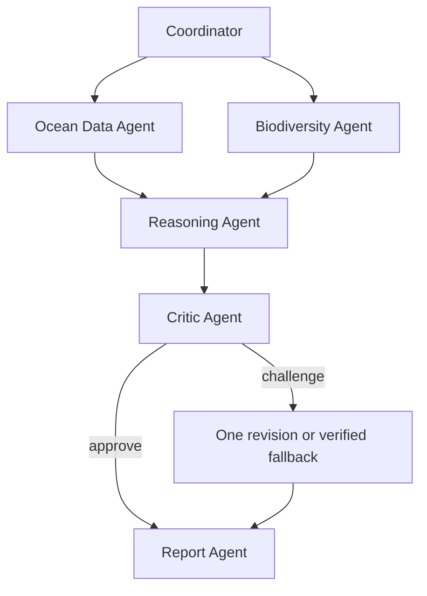

# ORCA university project: methods and demonstration

## Objective

Evaluate whether specialist collaboration plus critique can make an LLM's marine heat-stress report better grounded than a single LLM answer on identical evidence. This prototype focuses on coral thermal stress; it does not diagnose coral health.

## Architecture

FastAPI handles source selection, upload, and report requests; the frontend is plain HTML, CSS, and JavaScript. Specialist computations are deterministic. When a server API key is set, separate LLM turns generate the proposal, independent critique, and at most one revision. The final report includes evidence IDs, an agent trace, limitations, time, and token counts.

## Data and reproducibility

- Synthetic example: `data/sample.csv`, with explicit positive, negative, and missing observations.
- Real example: `data/florida_keys_2023_excerpt.txt`, 10–21 August 2023, transcribed from NOAA Coral Reef Watch's [Florida Keys Regional Virtual Station archive](https://coralreefwatch.noaa.gov/product/vs/data/florida_keys.txt). The parser checks the archive header and column order. Test assertions reproduce DHW 18.3257 °C-weeks and seven-day maximum alert code 6 for 15 August.
- Optional live import reads the same fixed NOAA URL and filters a selected window; the bundled excerpt is used for offline reproducibility.
- Missing observation means no record in the selected dataset, not that no bleaching happened. Satellite measurements and direct observations must not be conflated.

## Evaluation protocol

Run `python -m evaluation.run --output evaluation/baseline_results.json` from the repository root. The 20 annotated cases cover three synthetic reefs and five windows of the NOAA excerpt, including missing dates. Labels specify the teaching risk category and whether a positive observation is present. The saved deterministic result is 20/20 on each of risk, evidence-ID support, observation-claim, and abstention checks; it uses zero LLM calls. These cases overlap and are derived from the implementation's threshold rule, so this is a smoke and reproducibility result, not a generalization claim.

With a valid `OPENAI_API_KEY`, run `python -m evaluation.run --llm` and `python -m evaluation.run --single-agent` on the same cases. Record model version, run date, latency, token counts, and outputs before drawing comparative conclusions. The single-agent baseline receives the same evidence records but no specialist allowed-claims list or critic. Current case annotations and automatic claim checks are insufficient to score all nuanced prose; manually inspect summaries using a rubric for factual support, uncertainty, and unsupported causal statements. A larger independently annotated set is needed for a research-grade comparison.

## Demo script (three minutes)

1. Start the server from the README and show the synthetic example. Explain the specialist and critic roles and inspect the evidence IDs.
2. Load the offline NOAA Florida Keys example. Select 10–21 August 2023. Show the peak DHW, NOAA alert code, source URL, and the missing direct bleaching observations.
3. Explain that “high” is ORCA's teaching category, distinct from NOAA's alert code. Show the agent trace and metrics.
4. Show the 20-case evaluation output and state its limits. With a key available, repeat with LLM mode and demonstrate a challenged proposal or describe the bounded revision path.

## Limits and next research work

The excerpt is regional and historical. It lacks matched field observations. The live fetch depends on NOAA availability. Data stays in server memory. Risk thresholds are illustrative; there is no ecological prediction model or causal inference. The hard validator constrains claims and selected risky phrases but cannot prove every natural-language sentence. The final assessment requires independent labels, human review, and actual LLM runs.
